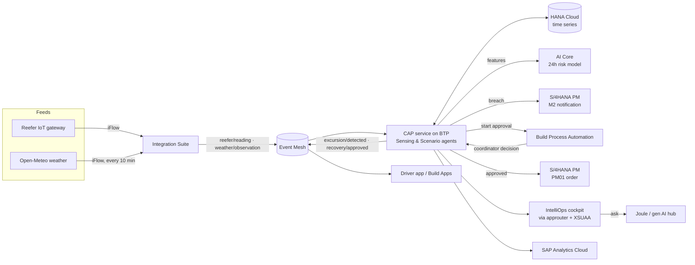

# IntelliOps · Cold Chain Guardian — SAP stack mapping

IntelliOps watches vaccine reefers in transit. When a load warms past **8 °C** it
predicts how long until the batch is lost, raises the maintenance paperwork in
S/4HANA, and puts a recovery decision in front of a human, all on SAP BTP.

The React app keeps its original modules (Login, Cockpit, Incident, Recovery,
Evidence, History, Live map, Driver). The SAP layer lives in `btp/` and is reached
from the app through `src/lib/sap.js`.

## Service mapping

| Need | SAP service | Where in this repo |
|---|---|---|
| Platform hosting everything | **SAP BTP** (Cloud Foundry): CAP service + approuter + XSUAA | `btp/mta.yaml`, `btp/xs-security.json`, `btp/app/router` |
| Store & query time-series sensor + weather data | **SAP HANA Cloud** (HDI container) | `btp/db/schema.cds` → `SensorReadings`, `WeatherObservations`, `GpsPositions`, `ShipmentTemperatureStats` |
| Live GPS tracking | Browser Geolocation API in the driver app (no key) → Supabase realtime to the coordinator map + Event Mesh topic `…/vehicle/position` → HANA Cloud `GpsPositions` | `src/DriverDashboard.jsx`, `src/LiveMap.jsx`, CAP action `ingestPosition` |
| Dashboard | **React cockpit** served by the BTP approuter; OData V4 service ready for **SAP Analytics Cloud** (live connection) or a **Fiori elements** app | `src/`, `btp/srv/coldchain-service.cds` |
| Ingest live feeds (reefer IoT, outside-air weather) | **SAP Integration Suite** iFlows → **SAP Event Mesh** topics | `btp/integration-suite/README.md`, `btp/event-mesh.json`, local stand-ins in `btp/feeds/` |
| Alert workflow (human in the loop) | **SAP Build Process Automation** — "Cold-chain recovery approval" | `btp/bpa/`, `btp/srv/adapters/bpa.js` |
| Mobile app for field staff | Driver view in the app today; **SAP Build Apps** on the same OData service | `src/DriverDashboard.jsx`, `btp/bpa/README.md` |
| The payoff | **S/4HANA Plant Maintenance**: M2 malfunction notification on the reefer's equipment at breach; PM01 order on approval | `btp/srv/adapters/s4-pm.js` (API_MAINTNOTIFICATION, API_MAINTENANCEORDER) |
| Predictive | **SAP AI Core**: 24 h excursion-risk model (KServe) | `btp/ai-core/`, `btp/srv/adapters/aicore.js` |
| Natural-language questions | **Joule** / AI Core generative AI hub, grounded on HANA data | `btp/srv/adapters/joule.js`, CAP action `ask` |

## Flow



**At breach** (`srv/coldchain-service.js → handleExcursion`):
1. Reading arrives on Event Mesh (`…/reefer/reading`) and is stored in HANA Cloud.
2. **Sensing agent** (`lib/rules.js`): above 8 °C = excursion; still in range but rising fast = watch.
3. **Scenario agent**: a 150-minute exposure budget, burnt faster the hotter the load, gives the time to breach.
4. **AI Core** scores the 24 h risk from temperature, slope, outside air, stationary time, door openings and trip length.
5. **S/4HANA PM** gets an M2 notification (priority 1) on the reefer's equipment.
6. **Build Process Automation** starts the approval; **Compliance agent** blocks automatic disposition.
7. `…/excursion/detected` goes out on Event Mesh for the driver app / Build Apps.

**On approval** (`approveRecovery`): the BPA task is completed, a PM01 order is created from the
notification, and `…/recovery/approved` is broadcast. HackFest agent categories map as:
Sensing & Scenario → rules + AI Core; Logistics & Inventory → recovery options + S/4 PM;
Compliance & Human-in-the-Loop → BPA gate.

## Mock vs live

Every SAP touchpoint has a mock and a live mode, so the demo runs anywhere.

| Setting | Local default | On BTP (`[production]` profile) |
|---|---|---|
| Frontend `VITE_SAP_MODE` | `mock` (in-browser) or `live` (CAP via Vite proxy) | `live` (`.env.btp`) |
| Database | SQLite in memory | HANA Cloud |
| Messaging | `local-messaging` | Event Mesh (`enterprise-messaging-shared`) |
| Auth | dummy user | XSUAA (roles `IntelliOps_Coordinator`, `IntelliOps_Driver`) |
| S/4, BPA, AI Core, Joule | mock adapters | live via BTP destinations |

Override any setting with env vars on the `intelliops-srv` app, e.g.
`cds_intelliops_s4_mode=mock` to demo on BTP without an S/4 system.

## Run locally

```bash
# 1. SAP backend (CAP)
cd btp
npm install
npm run dev              # http://localhost:4004  (OData: /odata/v4/coldchain)
npm test                 # 17 tests: rules, risk model, Joule intents, full pipeline, GPS

# optional live feeds
npm run simulate -- --heat CN-24018   # reefer IoT readings -> Event Mesh
npm run weather                       # Open-Meteo -> Event Mesh

# 2. Frontend (project root), in another terminal
echo "VITE_SAP_MODE=live" >> .env     # or leave unset for the in-browser mock
npm run dev
```

In the cockpit, **Simulate temperature event** now runs the SAP pipeline. The agent list shows
which SAP service did each step. The **Joule** toggle in the search bar answers questions such
as "Which shipments are at risk today?". The **Risk 24h** column comes from AI Core, and the
Incident screen shows the S/4HANA notification. Approving on Recovery completes the BPA task
and creates the PM order. Evidence lists the full SAP audit trail.

## Deploy to SAP BTP (HackFest subaccount)

Prerequisites in the subaccount: Cloud Foundry space, HANA Cloud instance, entitlements for
Event Mesh (`enterprise-messaging`), XSUAA, Destination, and the tools `cf` + `mbt`.

```bash
cd btp
mbt build            # builds CAP, HANA artifacts and the React app into mta_archives/
cf deploy mta_archives/intelliops-coldchain_1.0.0.mtar
```

Then:
1. **Role collections**: assign `IntelliOps_Coordinator` to coordinators.
2. **Destinations** (BTP cockpit → Connectivity → Destinations):

| Name | URL | Auth |
|---|---|---|
| `S4HANA_PM` | your S/4HANA host (or via Cloud Connector) | Basic / OAuth2SAMLBearer / PrincipalPropagation |
| `SBPA_API` | `api` from the SBPA service key | OAuth2ClientCredentials |
| `AICORE` | `AI_API_URL` from the AI Core service key | OAuth2ClientCredentials |

3. **AI Core**: follow `btp/ai-core/README.md`, then set `cds_intelliops_aicore_deploymentId`
   (and `cds_intelliops_joule_deploymentId` for a chat model) on `intelliops-srv`.
4. **BPA**: build the process from `btp/bpa/README.md` and set `cds_intelliops_bpa_definitionId`.
5. **Integration Suite**: create the two iFlows in `btp/integration-suite/README.md`.
6. **SAP Analytics Cloud**: live connection to the HANA Cloud HDI container
   (view `ShipmentTemperatureStats`), or an OData import of `/odata/v4/coldchain`.

## Honest limits of this prototype

- **Login and the driver app's realtime updates still use Supabase.** The target state
  replaces them with XSUAA (already configured in the approuter) and an Event Mesh WebSocket
  subscription or Build Apps.
- **The S/4HANA payloads use the standard released-API field names.** Mandatory fields
  (planning plant, work centre, catalog codes, order type) depend on your S/4 configuration;
  check them against the system's `$metadata`.
- **The AI Core model is trained on synthetic data** (`train.py`) until real excursion history
  in HANA Cloud can be used.
- **Joule itself is not configured here.** The `ask` action is the grounded Q&A endpoint that
  a Joule Studio custom skill (or the cockpit) calls.
